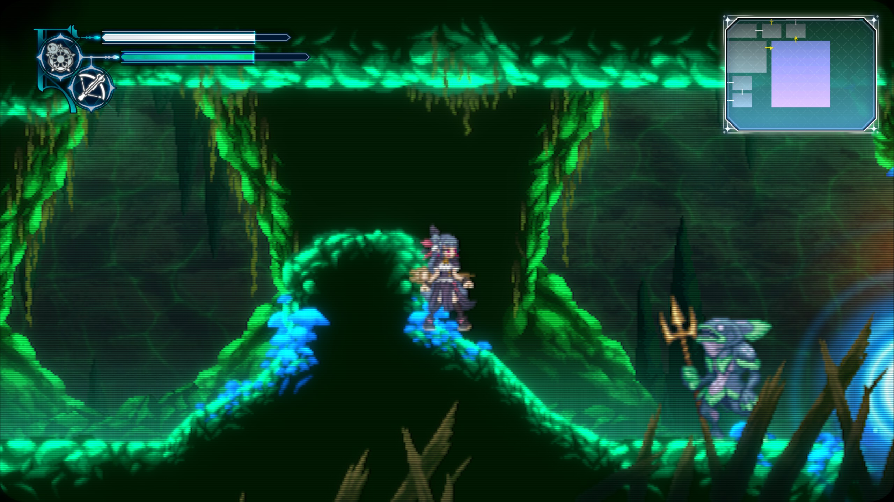
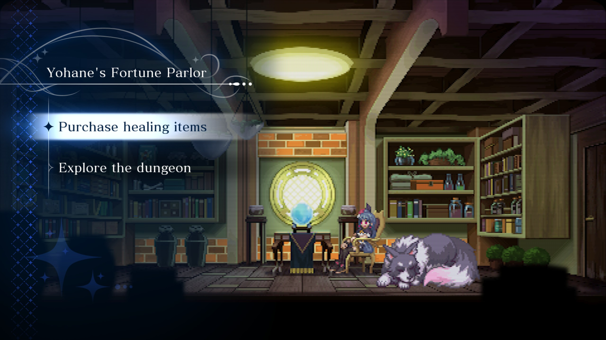
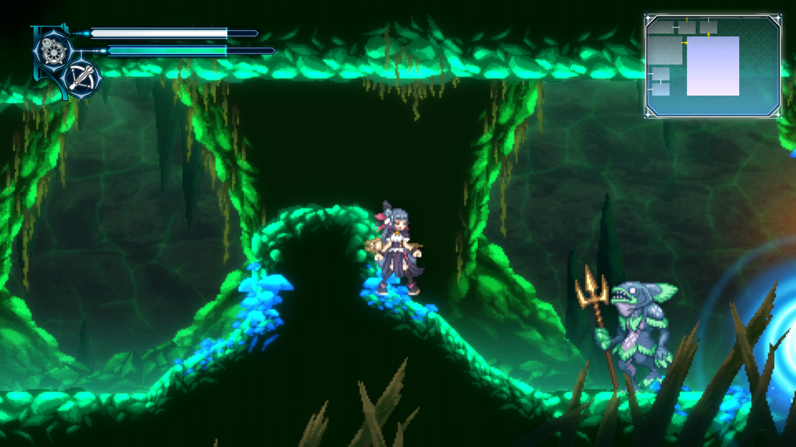
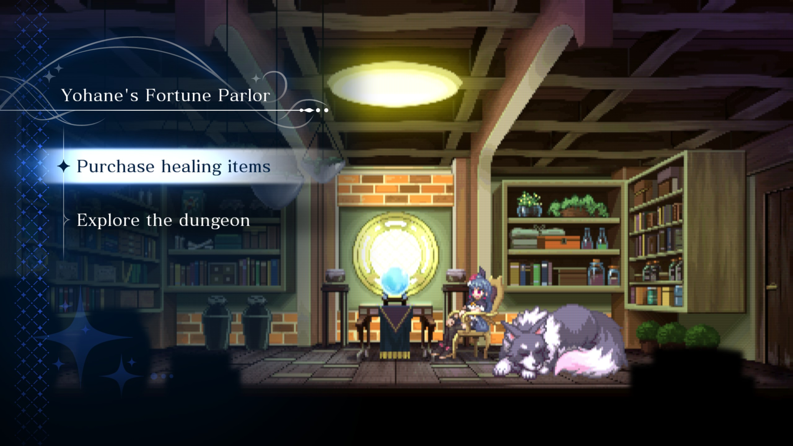

# Yohane CRT

A CRT filter for **YOHANE THE PARHELION -BLAZE in the DEEPBLUE-** (Steam, Windows) that applies
only to the level graphics. The HUD, minimap, menus, dialogue boxes and cutscene art stay
sharp, exactly as the game draws them.

The game draws its pixel art on a 480×270 grid and then paints its high-resolution HUD on top. This mod
slots a CRT shader in between those two steps, so the scanlines and phosphor mask land on the
pixel art and nothing else.

It ships with two filters, and you can switch between them in game:

| Filter | Look |
|---|---|
| **crt-geom** (`crt-geom.hlsl`, the default) | The classic cgwg CRT shader from RetroArch: shaped scanlines and a magenta/green phosphor mask. Flat screen with softly rounded corners, slightly brightened |
| **Basic** (`crt.hlsl`) | Soft scanlines that thicken on bright pixels, light horizontal blur, faint RGB stripes. Square corners |

## Screenshots

Captured at 2560×1440. The HUD, minimap and parlor menu stay sharp while the pixel art is filtered.

**crt-geom**, in a level and in the fortune parlor:

**Basic**, same scenes:

## Install

1. Download the latest `YohaneCRT-<version>.zip` from Releases.
2. In Steam, right-click the game → **Manage** → **Browse local files**.
3. Extract the zip into that folder. `D3DCOMPILER_43.dll` should sit next to `game.exe`, with a
   `crt` folder beside it.
4. Start the game. crt-geom is on from the first level.

## Controls

| Key | Action |
|---|---|
| **F7** | Switch filter (crt-geom ↔ Basic). If the filter is off, turns it back on |
| **F9** | Filter on/off, for comparing |
| **F8** | Reload the filter files after editing them |

Your choice is remembered between launches.

## Tuning

Each filter is a plain text file in the `crt` folder with its settings at the top. Edit one in
any text editor, save, and press **F8** in game to see the change immediately. If an edit has a
mistake, the game keeps the last working version and writes the error to `crt\log.txt`.

Useful settings:

- **Basic:** `SCANLINE_STRENGTH` (0–1, how dark the gaps are), `SHARPNESS` (lower is crisper),
  `BRIGHTNESS`, `MASK_STRENGTH` (0 turns off the RGB stripes), `CURVATURE` (0 is flat; try 0.04)
- **crt-geom:** `scanline_weight` (line thickness), `DOTMASK` (mask strength), `lum` and
  `monitorgamma` (brightness; going above about 2.6 on `monitorgamma` looks washed out)

Any other `.hlsl` file you put in the `crt` folder also shows up as a filter option.

## Uninstall

Delete `D3DCOMPILER_43.dll` and the `crt` folder from the game folder. Steam's "Verify integrity
of game files" won't remove them, because they aren't game files.

## Compatibility

- Tested on Steam build **12487807** (last game update 28 April 2024), Windows 11, DirectX 11.
- **If the game is updated**, the filter may stop attaching. The game keeps working normally,
  without the filter, and `crt\log.txt` says so. Check here for a newer version.
- **Steam Deck / Linux (Proton): untested.** It should work with this launch option, which tells
  Proton to load the mod's DLL:
  `WINEDLLOVERRIDES="d3dcompiler_43=n,b" %command%`
- **ReShade and other DirectX mods: untested.** Both hook the same graphics device, so if you
  combine them and something breaks, try without the other mod first.

## Troubleshooting

- **No filter at all:** check that `D3DCOMPILER_43.dll` is next to `game.exe`, not inside a
  subfolder, and look at `crt\log.txt`. A working install logs `CRT: loaded crt.hlsl, crt-geom.hlsl`.
- **Antivirus warning:** the mod works by standing in for a DirectX DLL the game loads, which
  some scanners flag in the same way they sometimes flag ReShade. The full source is in this
  repository, and each release lists the SHA-256 hash of the DLL so you can check you have the
  real file.

## How it works

The game loads `D3DCOMPILER_43.dll` from its own folder at startup, before it creates its
graphics device, but never actually uses it. This mod's version forwards those functions to the
real Windows DLL and uses the early start to watch the game's graphics device. When the game
creates the shader it uses to copy the finished level image back before adding glow and the HUD,
the mod recognises it by its fingerprint. Every time the game draws with it, the mod draws
with the selected CRT shader instead.

A few scenes, such as the fortune parlor, are pixel art drawn entirely through the game's menu
system, so that copy step never happens. For those, the mod recognises the scene's texture sheet
by its contents and, once the scene's art has been drawn, runs the filter as an extra pass of its
own before the game draws the menu on top. Those are the only changes to the game's rendering.

[DEVELOPMENT.md](DEVELOPMENT.md) covers how the rendering pipeline was mapped, with frame
captures, and how to add more RetroArch shaders.

## Building from source

Visual Studio 2022 with the C++ desktop workload. Run `shaderlog\build.bat`, which produces:

- `shaderlog\release\D3DCOMPILER_43.dll`, the release build
- `shaderlog\D3DCOMPILER_43.dll`, a diagnostic build that also dumps the game's shaders and can
  record full frames with F10/F11 for investigating the rendering pipeline

`package.ps1` builds the release zip and its checksums into `dist\`.

## Credits and licence

- **crt-geom** by cgwg, Themaister and DOLLS (GPL v2 or later), ported from RetroArch's
  [slang-shaders](https://github.com/libretro/slang-shaders).
- Mod, Basic filter and HLSL ports 100% vibe coded, at my direction.

Released under the GNU General Public License, version 2 or later. See [LICENSE.txt](LICENSE.txt).

Not affiliated with or endorsed by the game's developers or publishers.
